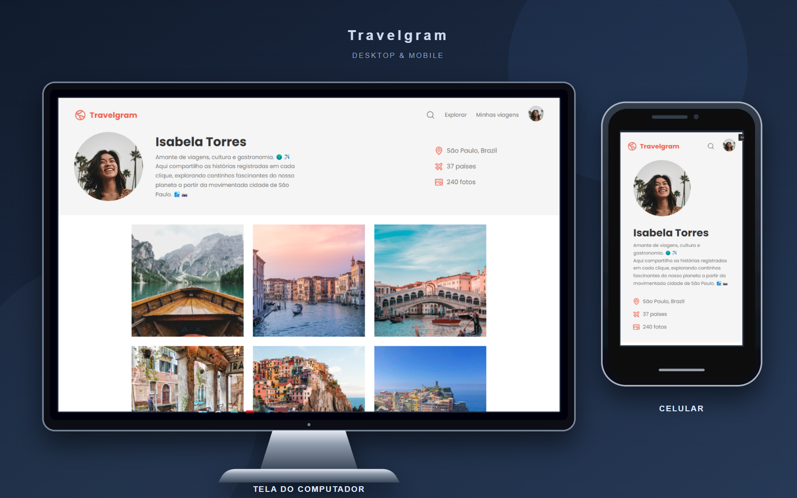

# Travelgram — Perfil de viagens

O Travelgram é uma página estática que apresenta o perfil de uma viajante e suas fotografias. O layout reúne informações sobre a pessoa, como localização e quantidade de países visitados, além de uma galeria com registros de viagem.

  

## Funcionalidades

- Cabeçalho com a identidade visual do Travelgram e links de navegação.
- Perfil da viajante com descrição, localização e estatísticas.
- Galeria com 12 fotografias.
- Layout responsivo para diferentes tamanhos de tela.

## Tecnologias

- HTML5
- CSS3
- Google Fonts: Poppins

## Como visualizar

Acesse a versão publicada: [Travelgram — Perfil de viagens](https://edivilhian-h.github.io/Travelgram/).

## Observação

Este é um projeto estático feito com HTML e CSS. Os links de navegação, pesquisa e informações do rodapé são apenas visuais e não estão conectados a outras funcionalidades.
